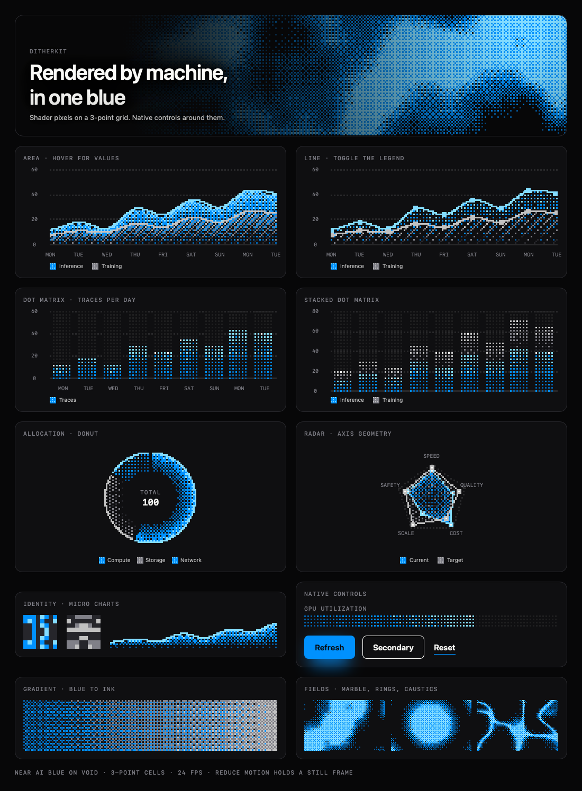
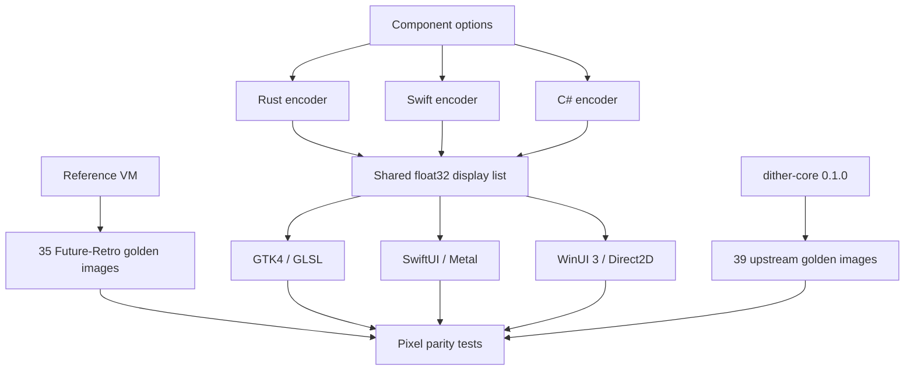

# DitherKit Native

Native shader-driven ports of [dither-kit-rs](https://github.com/DeepanshuMishraa/dither-kit-rs) for GTK4, SwiftUI, and WinUI 3. Ordered dithering happens on a small pixel grid; native controls provide text, input, layout, and accessibility. The default dither cell is 3 logical pixels.

Components default to [Future-Retro](docs/FUTURE-RETRO.md) styling: Near AI blue on void, every lit pixel one of four ramp steps chosen by ordered dither, dot-matrix bars, drifting cloud fields at 24 fps, and flat native buttons. dither-core's multi-hue tones remain available and pixel-identical to upstream.





The display-list format, numerical rules, component scope, and roadmap are in [PLAN.md](PLAN.md). The dependency-free [Rust IR](rust/dither-ir/src/lib.rs) and its reference interpreter define the shader behavior. Programs contain drawing operations followed by geometry tables. A bloom operation separates base content from hover overlays.

## GTK4

Requires Rust 1.92 or newer, GTK 4.10 or newer, libepoxy, and OpenGL 3.3 or OpenGL ES 3. On Ubuntu 24.04:

```sh
sudo apt-get install libgtk-4-dev libepoxy-dev libegl1-mesa-dev libgl1-mesa-dri libgl-dev xvfb
cd rust
cargo run -p dither-gtk --example gallery
```

Use the local crate as a dependency:

```toml
[dependencies]
dither-gtk = { path = "path/to/dither-kit-native/rust/dither-gtk" }
```

The GTK port loads system libepoxy through `libloading`; the older Rust `epoxy` crate cannot resolve its yanked transitive dependencies. Rendering uses two grid-size RGBA8 targets and nearest-neighbor scaling.

Inside a GTK application, construct a component and attach its native widget:

```rust
use dither_gtk::{DitherBackground, install_future_retro_css, ir::{Background, Field, Tone}};
use dither_gtk::gtk::prelude::*;

install_future_retro_css(&window.display());
let clouds = DitherBackground::new(Background::new(Field::Clouds, Tone::Near));
window.set_child(Some(clouds.widget()));
```

## SwiftUI

Requires macOS 14 or iOS 17, Xcode, and its Metal compiler. Add `swift/` as a local Swift package, then import `DitherKit` for views or `DitherIR` for pure encoders.

```sh
swift test --package-path swift
swift run --package-path swift DitherGallery
```

The package builds its Metal resource for SwiftPM. If Xcode reports a missing Metal toolchain, install it with `xcodebuild -downloadComponent MetalToolchain`.

```swift
import DitherKit

DitherGradient(from: .near, to: .ink, direction: .right)
    .frame(height: 120)
DitherMeter(value: 0.65, label: "Capacity")   // Near AI blue dot matrix
Button("Download") {}.buttonStyle(DitherButton())   // flat Near AI blue
```

## WinUI 3

Requires Windows, the .NET 8 SDK, Visual Studio Windows application build tools, and the Windows SDK 10.0.22621.0. The minimum runtime OS is Windows 10 build 19041. Pure `DitherKit.IR` and its fixture tests also run on Linux and macOS. `global.json` selects an installed .NET 8 feature band.

```powershell
msbuild windows/DitherKit.Gallery/DitherKit.Gallery.csproj /restore /p:Configuration=Release /p:Platform=x64
msbuild windows/DitherKit.WinUI.Tests/DitherKit.WinUI.Tests.csproj /restore /p:Configuration=Release /p:Platform=x64
dotnet test windows/DitherKit.WinUI.Tests/DitherKit.WinUI.Tests.csproj -c Release -p:Platform=x64 --no-build --no-restore
```

Reference `windows/DitherKit.WinUI/DitherKit.WinUI.csproj` for controls or `windows/DitherKit.IR/DitherKit.IR.csproj` for pure encoders. ComputeSharp provides the Direct2D pixel shader; Win2D scales its grid-resolution render target with nearest-neighbor interpolation.

```csharp
using DitherKit.WinUI;

var gradient = new DitherGradient { Width = 360, Height = 120 };
gradient.SetOption("from", "near");
gradient.SetOption("to", "ink");
Content = gradient;
```

## Shared fixtures and validation

```sh
cd rust
cargo test --workspace
cargo run -p dither-golden -- ../fixtures --check
# Intentionally regenerate after reviewing upstream/version changes:
cargo run -p dither-golden -- ../fixtures
```

`--check` compares the reference VM against pinned upstream `dither-core = "=0.1.0"` for the 39 upstream scenes and against the committed PNGs for the 35 Future-Retro scenes, then verifies the committed scene parameters, encoded programs, and decoded PNG pixels without rewriting them. Swift and C# tests independently encode fixture parameters and compare display lists within `1e-4`. Platform golden tests compare shader output with the same PNGs.

Logical shader tests permit a maximum channel difference of 2 and at most 1% nonidentical pixels. Tests use straight RGBA transport to avoid lossy unpremultiplication; normal output uses premultiplied alpha for native compositing. Swift additionally checks the production compositing path. See the [pixel-transport notes](docs/EXECUTION.md#review-and-pixel-transport).

```sh
dotnet test windows/DitherKit.IR.Tests/DitherKit.IR.Tests.csproj
swift test --package-path swift
```

[CI](.github/workflows/ci.yml) uses Ubuntu for Rust/GTK/Mesa and C# encoders, macOS for Swift/Metal, and Windows for WinUI/Direct2D. See [execution evidence](docs/EXECUTION.md) for actual validation results and remaining platform limits. No package-registry release is implied by a source build.

## Credits and license

Based on Deepanshu Mishra’s [dither-kit-rs](https://github.com/DeepanshuMishraa/dither-kit-rs), including `dither-core` 0.1.0, and inspired by [Boring Software’s dither-kit](https://github.com/Boring-Software-Inc/dither-kit). Color and dithering behavior, geometry, and golden fixtures derive from upstream.

Dual licensed under [MIT](LICENSE-MIT) OR [Apache-2.0](LICENSE-APACHE), matching upstream. Original copyright notices are retained.
